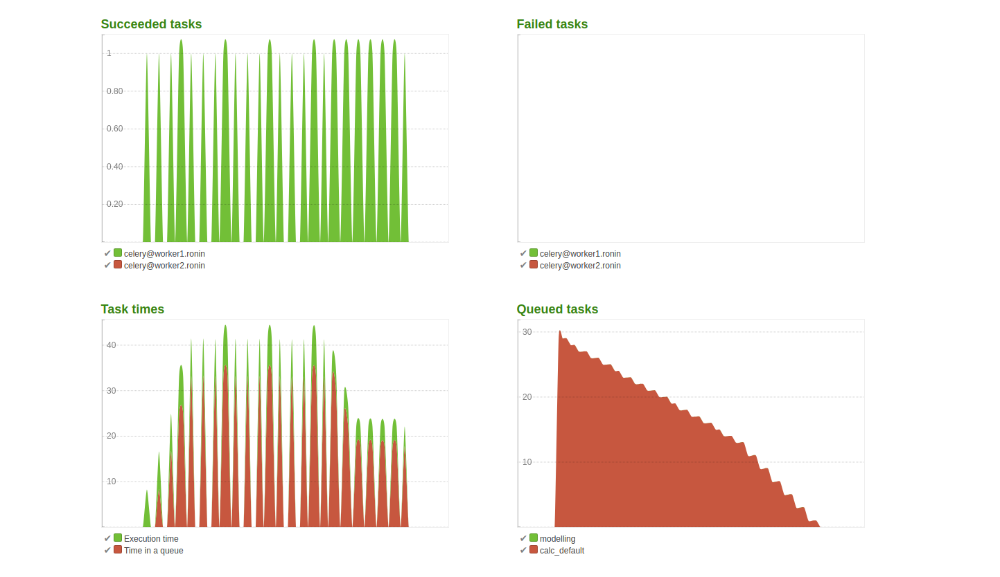
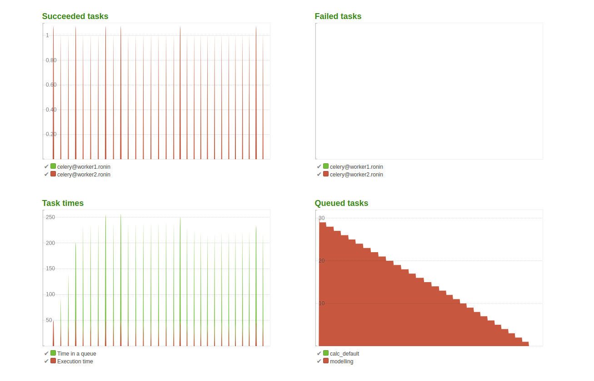
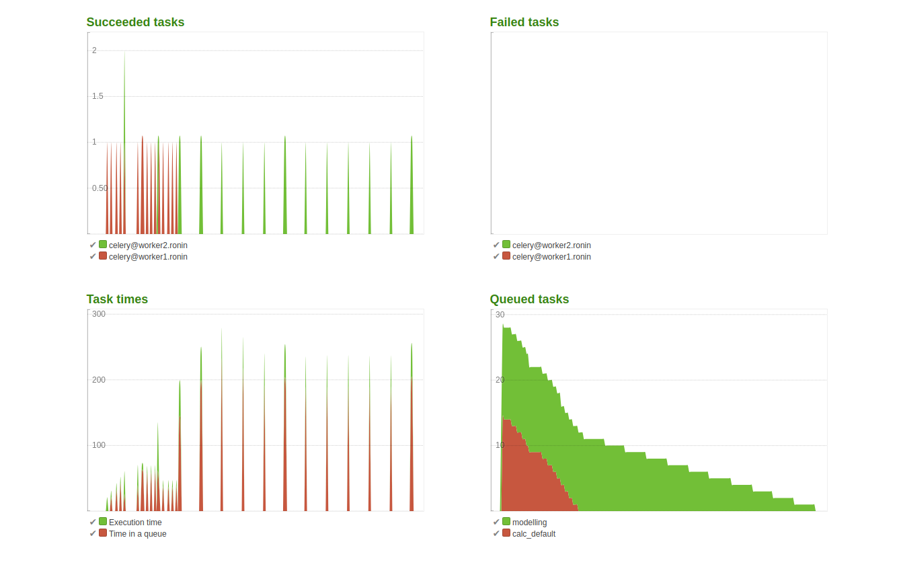

###########
Performance
###########

.. note::
    The load tests below were run in 2018 on the earlier version of the application, which used websockets and a
    full matrix inversion for every scenario. Since then, scenarios use a Woodbury update of the Leontief
    inverse (see :doc:`modelling`), which is much faster and uses less memory. Run the tests again on your own
    server before you size it. The worker settings below are still valid.

Worker settings
===============

* ``--max-tasks-per-child 1``: a worker process ends after one task. This returns its memory to the system.
* ``--concurrency 1`` for each worker: one task at a time. Users wait in a first-in, first-out queue.
* One worker for the ``calc_default`` queue and one worker for the ``modelling`` queue.
* ``OPENBLAS_NUM_THREADS``: limits the cores that numpy uses. Use a low value for default calculations and a
  higher value for scenarios.
* ``MODELLING_MEM_LIMIT`` (default 6 GB): a memory cap for the ``modelling`` container in ``docker-compose.yml``.
  A scenario that needs a full inversion uses about 2.3 GB on top of the memory-mapped matrices.
* ``RAMASCENE_MAX_ACTIVE_JOBS`` (default 50): the API returns HTTP 429 above this number of active jobs.

To watch the queues, use Celery Flower or the RabbitMQ management page (the ``broker`` container includes it).

Load tests (2018)
=================

Server: Dell PowerEdge R320, Intel Xeon E5-1410 v2 at 2.80 GHz, 8 cores, 8 GiB memory.

Testing scenarios and simultaneous requests
===========================================
The longest calculation route is the one with the selections TreeMap and Consumption view. For simplicity we use
"value added" as the indicator coupled with "total" for product and countries. All scenarios use this selection.
For modelling we select "totals" for all categories except "consumed by" which contains the "S: Agriculture, hunting and forestry" aggregate.
A single technical change is set to an arbitrary value of 100.

* Scenario A [Analytical]: 30 analytical request whereby 17 requests cover all years. and 13 request use the year 2011.
* Scenario B [Modelling]: 30 modelling request whereby 17 requests cover all years. and 13 request use the year 2011. All requests do heavy calculations covering the modelling of intermediates.
* Scenario C [Analytical + Modelling]: 15 requests over 15 different years for analytical and 15 request over 15 different years for modelling.

Idle MEM use at point before load test: 572M

Results scenario A
==================
* Max. time for a given task: 8.3 sec.
* Total time for the last user to finish the task: 4 min. and 58 sec.
* Highest detected MEM load: 2.87G (includes the idle MEM)

Conclusion:

The queued task in the right bottom plot show expected behaviour due to the concurrency set to 1.
The time in queue for a given task is relatively long compared to the time take to do calculations.
This was expected as the CPU use is limited coupled with no simultaneous requests.

Results scenario B
==================
* Max. time for a given task: 48.97 sec.
* Total time for the last user to finish the task: 22 min. 59 sec.
* Highest detected MEM load: 3.49G (includes the idle MEM)
* Execution time of the first task: 46.09 sec.

Conclusion:

CPU use is less limited for modelling and it can use 5 cores if needed, however that only speeds up execution time.
The last user still has to wait considerable time as opposed to the analytical queries. The spikes in the two plots on the left show that
there are no concurrent requests handled as set in the settings.

Results scenario C
==================
* Max. time for a given analytical task: 9.48 sec.
* Total time for the last user to finish the task for analytics: 3 min. 28 sec.
* Max. time for a given modelling task: 49.36 sec.
* Total time for the last user to finish the task for modelling: 11 min. 55 sec.
* Highest detected MEM load: 6.44G (includes the idle MEM)

Conclusion:

As shown in the top left and bottom right graph both workers are active. The analytical queue depletes faster than the modelling queue,
which is also expected and desired behaviour. The MEM load has increased as both workers use memory.

Final conclusion
================

Modelling has a significant impact on CPU use, in turn a limit is set on CPU considering the specs of the tested server.
This limit results in relatively long waiting time for users doing modelling. To circumvent this either a server with more powerful specs is required or
celery can be configured with workers on different machines. In both cases more CPU is required and optimally more memory.
If more memory is in place, logically concurrency can be increased however new load tests have to be performed.